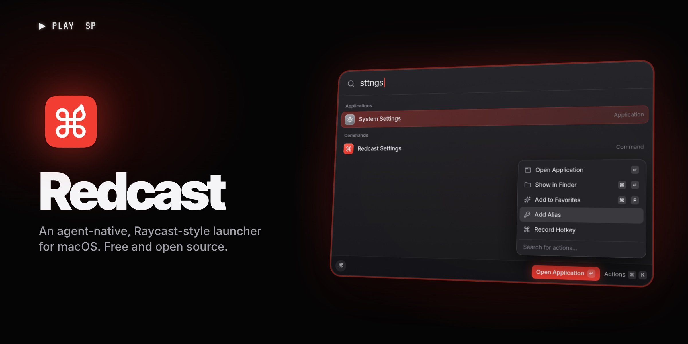

<p align="center">
  <a href="https://redcast.io"></a>
</p>

<h3 align="center">The free, open-source Raycast replacement for macOS.</h3>

<p align="center">
  Native and local-first. Your own models, your own agents, your own voice.<br>
  No Electron, no account, no subscription, no telemetry.
</p>

<p align="center">
  <a href="https://github.com/alesha-pro/redcast/releases/latest"></a>
</p>

<p align="center"><code>brew install --cask alesha-pro/redcast/redcast</code></p>

<p align="center">
  <a href="https://github.com/alesha-pro/redcast/releases/latest"></a>
  
  
  
  <a href="LICENSE"></a>
</p>

<p align="center">
  <a href="#install"><b>Install</b></a>&nbsp;&nbsp;·&nbsp;&nbsp;<a href="#features"><b>Features</b></a>&nbsp;&nbsp;·&nbsp;&nbsp;<a href="docs/README.md"><b>Docs</b></a>&nbsp;&nbsp;·&nbsp;&nbsp;<a href="https://redcast.io"><b>redcast.io</b></a>
</p>

<br>

Press one hotkey anywhere and a palette opens for your apps, files, windows, clipboard, snippets,
commands and **real Raycast extensions**. AI answers on the models and subscriptions you already have,
your agents work in your folders, and you can talk to any text field. Redcast is written in SwiftUI
and AppKit, stays under 100 MB and does nothing while you're not using it.

<table>
  <tr>
    <td width="50%" valign="top">
      <h3>⌘ Everything Raycast did</h3>
      Root search that learns, aliases and hotkeys, clipboard history, snippets, quicklinks, window
      management, a calculator, calendar, notes, emoji and system commands — plus the Raycast
      extensions you know, from a built-in store.
    </td>
    <td width="50%" valign="top">
      <h3>✦ AI on your terms</h3>
      Quick AI in the palette and a full AI Chat on OpenAI, Anthropic, Gemini, OpenRouter, a local
      server or your ChatGPT plan via <b>Sign in with ChatGPT</b>. Bring a key or a subscription;
      nothing is resold.
    </td>
  </tr>
  <tr>
    <td width="50%" valign="top">
      <h3>◎ Agents built in</h3>
      Agents live in a folder with tools, skills and memory, and run in the background or on a
      schedule. Claude Code, Codex, Gemini CLI, OpenCode, Goose and Hermes are one hotkey away.
    </td>
    <td width="50%" valign="top">
      <h3>◉ Voice everywhere</h3>
      Dictate into any field, on-device or in the cloud, with modes that polish or translate as you
      speak — and ask about the window in front of you.
    </td>
  </tr>
</table>

## Install

<table>
  <tr>
    <td align="center" valign="top" width="33%"><b>1 · Download</b><br><br>Get <code>Redcast-x.y.z.dmg</code> from the <a href="https://github.com/alesha-pro/redcast/releases/latest">latest release</a>.</td>
    <td align="center" valign="top" width="33%"><b>2 · Drag</b><br><br>Open the disk image and drag <b>Redcast</b> into <b>Applications</b>.</td>
    <td align="center" valign="top" width="33%"><b>3 · Press</b><br><br>Open Redcast, record a hotkey in <b>Settings › General</b> and press it anywhere.</td>
  </tr>
</table>

Or with [Homebrew](https://brew.sh):

```sh
brew install --cask alesha-pro/redcast/redcast
```

- **Notarized by Apple**, so it opens without a warning — no `xattr`, no right-click dance.
- **Updates itself.** Redcast checks the releases once a day, shows what changed and installs in place.
  Turn it off in Settings › General, or run *Check for Updates* from the palette. Homebrew knows, and
  `brew upgrade` leaves it alone.
- **Needs** macOS 26 or later on Apple silicon.
- **Permissions are asked one at a time**, the first time a feature needs them ([which and why](#privacy-and-permissions)).

<details>
<summary><b>Build from source</b></summary>
<br>

You need Xcode 27 and a signing identity in your keychain: a Developer ID Application one is used
first, else an Apple Development one, which Xcode makes in Settings › Accounts › Manage Certificates
with a free Apple ID.

```sh
git clone https://github.com/alesha-pro/redcast.git && cd redcast
Scripts/install.sh --self-check   # what an install would do; builds nothing
Scripts/install.sh                # build, install /Applications/Redcast.app, relaunch
```

`install.sh` builds a Release for this Mac, signs it, verifies it, quits the running Redcast gracefully
and swaps the new copy in by rename, so an app is always installed. `--rollback` puts back the copy it
replaced. Privacy grants survive a reinstall as long as the signing identity stays the same; a build
that would change it is refused unless you pass `--accept-new-identity`.
More in [docs/shipping.md](docs/shipping.md).

</details>

## Features

<details open>
<summary><b>Palette and search</b></summary>

- **Root search** with fuzzy matching, ranking that learns what you open, favorites on <kbd>⌘1</kbd>–<kbd>⌘0</kbd> and **actions on every row** with <kbd>⌘K</kbd>.
- **Aliases** — type one and press <kbd>Space</kbd>. Change an alias or a hotkey right from <kbd>⌘K</kbd>.
- **Hotkeys for anything**: combos, double-tapped or single modifiers, and a **Hyper Key** on Caps Lock. Settings › Shortcuts lists them all and flags conflicts.
- **Fallbacks** when nothing matches: ask AI, search files, run it in the shell, define the word or open a quicklink.
- **Search Files** on Redcast's own disk index, **Search Menu Bar Items**, **Switch Windows**, **Apple Shortcuts** and **custom shell commands** with arguments.
- **Send to AI** (<kbd>⌘J</kbd>) from clipboard history, file search and dictation history.

</details>

<details>
<summary><b>Raycast extensions</b></summary>

- **Real Raycast extensions** — the same bundles Raycast runs, rendered as native SwiftUI in JavaScriptCore.
- **Extension Store** in the palette: Featured, Popular, Recently Updated, New and every category; <kbd>↵</kbd> installs, updates or opens.
- **Extension AI**: `AI.ask` and `useAI` answered by your own model, once you allow each extension.
- **Import from Raycast**: settings, aliases, hotkeys, favorites, snippets, quicklinks and clipboard history from a `.rayconfig`.

</details>

<details>
<summary><b>Text and clipboard</b></summary>

- **Clipboard history** for text, links, images, files and colours, with text recognised in images and PDFs, pins, filters and Paste Sequentially.
- **Snippets** that expand as you type, with Raycast's placeholders, tags and plain Markdown storage.
- **Quicklinks** with arguments, placeholders, tags and the app to open them in.
- **Quick Actions** on selected text anywhere — Fix Grammar, Rewrite, Translate, Summarize and your own, each with its model and hotkey.
- **Calculator** with units, currencies, crypto, time zones, dates and durations; **dictionary** and **emoji picker**.

</details>

<details>
<summary><b>Windows and your day</b></summary>

- **35 window actions** — halves, thirds, quarters, displays, Spaces, fullscreen — plus your own sizes and gaps.
- **Layouts** that open apps and place every window at once, and **Rooms**: a set of windows you walk into.
- **Notes** in a floating Markdown editor, **Calendar** with one-key meeting join and a menu-bar agenda, a **camera** preview before calls.
- **System commands** and **Uninstall** that takes an app's leftovers with it.

</details>

<details>
<summary><b>AI</b></summary>

- **Quick AI** in the palette (<kbd>Tab</kbd> from any query) with model, reasoning effort, web search and an agent of your choice.
- **AI Chat**: folders as projects with their own instructions, per-chat model and tools, edit / regenerate / branch any message, file links, archive, <kbd>⌘1</kbd>–<kbd>⌘9</kbd> and Keep on Top.
- **Your models**: OpenAI, Anthropic, Gemini, OpenRouter and any OpenAI-compatible server (Ollama, LM Studio), each with its own reasoning settings.
- **Your subscriptions**: **Codex (ChatGPT)** through Sign in with ChatGPT, and the installed Claude Code, Codex, OpenCode, Grok and Cursor CLIs.
- **Web search** (Exa, Parallel, DuckDuckGo, SearXNG, Brave, Tavily), **MCP servers** over stdio or HTTP with OAuth, and **Screen Awareness**: double-tap right <kbd>⌘</kbd> and the window in front joins the chat.
- **Usage**: tokens and cost per model and agent, by day, week or month.

</details>

<details>
<summary><b>Agents</b></summary>

- **Native agents** that live in a folder and read its `AGENTS.md`, skills and notes, with tools for files, the terminal, the web and memory — and permission asked before each change unless you allow more.
- **ACP agents**: Claude Code, Codex, Gemini CLI, OpenCode, Goose, Hermes or any Agent Client Protocol agent, on your own logins, with diffs and plans in AI Chat.
- **Background runs**: type `@agent do this` in the palette and it works without a window. **Schedules** run agents daily or every few hours, with a spend cap.
- **Agent Sessions**: every past Claude Code, Codex, Gemini CLI, OpenCode and Redcast session, searchable and resumed in its folder with one key.

</details>

<details>
<summary><b>Voice</b></summary>

- **On-device dictation** (NVIDIA Parakeet or Qwen3-ASR, 25+ languages) into any text field.
- **Cloud dictation** on your own OpenRouter, Gemini, OpenAI or OpenAI-compatible connection, including OpenAI's `gpt-transcribe` with a chat model of your choice for cleanup — spoken punctuation, your own spellings and modes like Polish or Translate, switched with <kbd>Tab</kbd>.
- **Ask and Edit by Voice**: ask about the window in front, hand it to an agent, or say how to change the selection.
- **Dictation History**: every transcript searchable; a failed one keeps its audio for a week to retry on another model.

</details>

<details>
<summary><b>Settings and data</b></summary>

- **Full backup** of every configuration — agents, MCP servers, AI connections, voice modes, extensions, hotkeys — optionally with your keys under a passphrase. Import previews everything and lands anything that runs code switched off.
- **settings.json** mirror for your dotfiles, and **8 languages**: English, Deutsch, Español, Français, 日本語, 한국어, Português, Русский, 简体中文.

</details>

## Light by design

<table>
  <tr>
    <td width="50%" valign="top"><b>Native and small</b><br>SwiftUI and AppKit, no Electron, no third-party dependencies, a 100 MB memory budget.</td>
    <td width="50%" valign="top"><b>Quiet when idle</b><br>No resident helpers: ACP agents stop after two idle minutes, voice keeps no process between presses, schedules wait as one sleeping task.</td>
  </tr>
  <tr>
    <td width="50%" valign="top"><b>Network on your terms</b><br>AI requests go only to providers you connect, when you ask. The only timed requests are the ones you set up, the daily exchange rates and the daily update check.</td>
    <td width="50%" valign="top"><b>Local data</b><br>Chats, notes, clipboard, dictation history and usage stay on your Mac. AI is off until you connect a provider.</td>
  </tr>
</table>

## Privacy and permissions

Each permission is asked for the first time a feature needs it, and lives in System Settings ›
Privacy & Security.

| Permission | Asked when you first |
| :-- | :-- |
| Accessibility | paste from clipboard history, expand a snippet, run a Quick Action, move a window, or read the window in front |
| Microphone | dictate, or ask or edit by voice |
| Screen Recording | turn on a window screenshot for Screen Awareness or voice |
| Calendars | use the calendar and meeting join |
| Automation | run a system action that scripts another app, use Show Info in Uninstall, or resume an agent session in a terminal |
| Camera, Bluetooth, Reminders | open the camera, toggle Bluetooth, or run an extension that uses reminders |

Full Disk Access is never requested; Search Files and Uninstall use it if you grant it yourself.
Snippets ship off, and with them on, what you type is matched on your Mac and never stored or sent.
Voice audio goes only to the connection you approved, and is kept only when a dictation fails — on
this Mac, for at most a week.

## Documentation

- **[docs/](docs/README.md)** — architecture, standards, testing, the design system and a page per feature
- **[FORK.md](FORK.md)** — what Redcast adds, and its roadmap
- **[docs/shipping.md](docs/shipping.md)** — `install.sh` and `release.sh`
- **[AGENTS.md](AGENTS.md)** — the short version, for coding agents working on this repository
- **[CONTRIBUTING.md](CONTRIBUTING.md)** — issues and pull requests are welcome

## Credits and license

Redcast is a modified version of [Tinycast](https://github.com/abue-ammar/tinycast) by Abue Ammar,
Copyright © 2026 Abue Ammar, distributed under the same [GNU Affero General Public License v3.0](LICENSE)
with no warranty. Much of the launcher is upstream's work. Redcast's changes, made from October 2026
on and listed in [FORK.md](FORK.md) and the git history, are Copyright © 2026 Alexey Fateev
([alesha-pro](https://github.com/alesha-pro)) under the same licence; since 2026-11-17 Redcast goes its
own way and no longer follows upstream. The app's About window shows the same notice.

Ported from other forks of upstream under the same licence: alias + Space, ⌘K alias and shortcut
editing, and the extension-runtime fixes — authors and commits in [FORK.md](FORK.md#credits).
Third-party work keeps its own licence, recorded in [NOTICE.md](NOTICE.md): window rooms after
[Rooms](https://github.com/saragordic/rooms) by Sara Gordić and the file index after
[fsearch](https://github.com/noahdunnagan/fsearch) by Noah Dunnagan (both MIT), model brand marks from
Simple Icons, Lobe Icons and OpenCode, and the optional dictation models (NVIDIA Parakeet, CC BY 4.0;
Qwen3-ASR, Apache 2.0).

<sub>Raycast is a trademark of its owner. Redcast is not affiliated with Raycast, and not endorsed by upstream's author.</sub>
