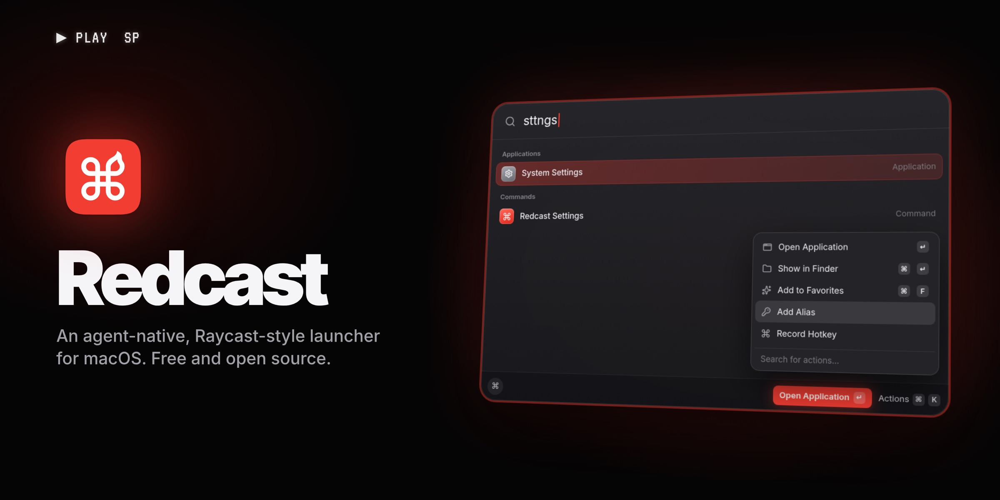

<p align="center">
  <a href="https://redcast.io"></a>
</p>

<p align="center">
  <strong>The free, open-source Raycast replacement for macOS.</strong><br>
  Native and local-first, with your own models, agents and voice.
</p>

<p align="center">
  <a href="https://redcast.io"></a>
  <a href="LICENSE"></a>
  
  
</p>

<p align="center"><a href="https://redcast.io"><b>redcast.io</b></a> · <a href="#install">Install</a> · <a href="docs/README.md">Docs</a> · <a href="FORK.md">What's new in the fork</a></p>

> **A fork that follows upstream.** Redcast is built on Abue Ammar's native macOS launcher and
> follows its `main` branch. Everything upstream does is here, and Redcast builds a lot on top:
> agents, AI Chat, voice, an extension store and more ([credits and license](#credits-and-license)).

**Redcast is a complete, free replacement for Raycast.** Press one hotkey anywhere and a palette opens
for your apps, files, windows, clipboard, snippets, commands and Raycast extensions. AI runs on
your own models and accounts, and your agents run there too. The app is native SwiftUI and AppKit:
no Electron, no account, no subscription and no telemetry, and it stays quiet when idle.

## Why Redcast

- **Everything you used Raycast for.** Root search, aliases and hotkeys, clipboard history,
  snippets, quicklinks, window management, the calculator, the calendar, notes, emoji, system
  commands and real **Raycast extensions**, installed from a built-in store.
- **AI on your terms.** Quick AI and a full AI Chat on any model you connect: OpenAI, Anthropic,
  Gemini, OpenRouter, a local OpenAI-compatible server, or your ChatGPT plan through
  **Sign in with ChatGPT**. Bring a key or a subscription; nothing is resold.
- **Agents built in.** Agents work in a folder with tools, skills and memory, run in the background or
  on a schedule, and the coding agents you already use (Claude Code, Codex, Gemini CLI, OpenCode,
  Goose, Hermes) are one hotkey away.
- **Voice everywhere.** On-device or cloud dictation into any field, modes that polish or translate
  as you speak, and questions about the window in front of you.
- **Free and open source.** AGPL-3.0, and your data stays on your Mac.

## Features

### Palette and search
- **Root search** with fuzzy matching, ranking that learns what you open, favorites on ⌘1–⌘0, and
  **⌘K actions** on every row.
- **Aliases**: type an alias and press Space to open it. Change an alias or a hotkey from ⌘K.
- **Hotkeys** for anything: combos, double-taps of a modifier, a single modifier, and a **Hyper Key**
  on Caps Lock. **Settings › Shortcuts** lists every hotkey and alias in one place and flags conflicts.
- **Fallbacks** for what nothing matched: ask AI, search files, run it in the shell, define the word,
  or open a quicklink.
- **Search Files** with Redcast's own index of the disk, kept current by FSEvents.
- **Search Menu Bar Items** presses any menu item of the app in front. **Switch Windows** raises any
  open window.
- **Apple Shortcuts** listed and run from the palette.
- **Custom commands**: shell commands with arguments, which can show their output.
- **Send to AI (⌘J)** from clipboard history, file search and dictation history.

### Raycast extensions
- **Real Raycast extensions**, the same bundles Raycast runs, rendered as native SwiftUI. No Electron,
  no browser.
- **Extension Store** in the palette: Featured, Popular, Recently Updated, New and every category,
  with ↵ to install, update or open.
- **Extension AI**: `AI.ask` and `useAI` answered by your own model, once you allow each extension.
- **Import from Raycast**: settings, aliases, hotkeys, favorites, snippets, quicklinks and clipboard history from a `.rayconfig`.

### Text and clipboard
- **Clipboard history** with text, links, images, files and colours. Text is recognised in images and
  PDFs, entries can be pinned and filtered by type, and Paste Sequentially is there.
- **Snippets** that expand when you type their keyword, with Raycast's placeholders (cursor, date,
  clipboard, other snippets), tags and plain Markdown storage.
- **Quicklinks** with arguments, placeholders, tags and the app to open them in.
- **Quick Actions** on selected text in any app: Fix Grammar, Rewrite, Translate and Summarize, plus
  your own actions, each with its own model, placeholders and a hotkey.
- **Calculator** with units, currencies and crypto, time zones, dates and durations, and a history.
- **Dictionary** from the dictionaries on your Mac, and an **emoji picker** with skin tones and pins.

### Windows
- **35 window actions**: halves, thirds, quarters, fourths, displays, Spaces and fullscreen, plus your
  own sizes and gaps.
- **Window layouts** that open apps and place every window in one go.
- **Rooms**: a named set of windows you walk into, with everything else stepped aside.

### Your day
- **Notes**: Markdown notes in a floating editor, with a switcher, pins, tasks and a menu bar item.
- **Calendar**: a join card for the next meeting, one-key join, meetings that join themselves, a
  menu bar agenda and **My Schedule**.
- **Camera** preview before a call, and a photo to the clipboard.
- **System commands**: lock, sleep, restart, empty the Trash, appearance, Bluetooth and more.
- **Uninstall** an app together with everything it left behind.

### AI
- **Quick AI** right in the palette (Tab from any query), with the model and reasoning effort beside it,
  web search, and an agent of your choice answering with its tools.
- **AI Chat**, a full window:
  - coloured folders that act as projects with their own instructions;
  - a settings sidebar per chat (model, reasoning, creativity, instructions, tools, context and cost);
  - edit, regenerate or branch from any message;
  - archive and Recently Deleted;
  - the files a reply names as links you can open, with a Files strip;
  - ⌘1–⌘9 to switch chats and Keep on Top.
- **Your models**: OpenAI, Anthropic, Gemini, OpenRouter and any OpenAI-compatible endpoint
  (Ollama, LM Studio), each with its own reasoning settings. Interleaved thinking is replayed per
  provider.
- **Your subscriptions**: **Codex (ChatGPT)** through Sign in with ChatGPT, and the installed Claude
  Code, Codex, OpenCode, Grok and Cursor CLIs.
- **Web search** with Exa, Parallel or DuckDuckGo out of the box, or your SearXNG, Brave or Tavily. A
  chat also reads the pages you link.
- **MCP servers** over stdio or HTTP, OAuth included, with per-chat tool choices.
- **Screen Awareness**: double-tap right ⌘ and the window in front (its text, selection and, if you
  allow it, a screenshot) joins the chat.
- **Usage**: tokens and cost per model and agent, by day, week or month.

### Agents
- **Native agents** that live in a folder and read its `AGENTS.md`, skills and notes:
  - tools for files, the terminal, the web, memory and notes;
  - permissions asked before each change unless you allow more;
  - effort levels from quick to thorough;
  - a message sent mid-run is queued or steers the agent at its next step.
- **Skills** from `~/.agents`, `~/.config/agents` and `~/.claude`, chosen per agent.
- **ACP agents**: Claude Code, Codex, Gemini CLI, OpenCode, Goose, Hermes or any other Agent Client
  Protocol agent, on your own logins, with their diffs, plans and model pickers in AI Chat.
- **Background runs**: type `@agent do this` in the palette and it works with no window, then
  ends as a chat. **Schedules** run an agent daily, on working days or every few hours, with a daily
  spend cap.
- **Agent Sessions**: every past Claude Code, Codex, Gemini CLI, OpenCode and Redcast session,
  searchable and resumed in its folder and terminal with one key, with optional live status.

### Voice
- **On-device dictation** (NVIDIA Parakeet or Qwen3-ASR, 25+ languages) into any text field.
- **Cloud dictation** on your own OpenRouter, Gemini or OpenAI-compatible connection:
  - spoken punctuation, lists and corrections;
  - your own spellings;
  - modes like Polish, Translate to English and As a message, switched with Tab.
- **Ask and Edit by Voice**: ask about the window in front, hand the request to an agent, or say how to
  change the selected text.
- **Dictation History**: every transcript searchable. A failed dictation keeps its audio for a
  week, so it can be retried on another model.

### Settings and data
- **Full backup** of every configuration, including agents, MCP servers, AI connections, voice modes,
  extensions and hotkeys. With a passphrase it can also carry your keys. Import shows a preview and
  lands anything that runs code switched off.
- **settings.json** mirror for dotfiles, and **8 languages**: English, Deutsch, Español, Français,
  日本語, 한국어, Português, Русский and 简体中文.
- **The Raycast look**, with command tiles coloured by family and a colour for every agent.

## Light by design

- **Native and small.** SwiftUI and AppKit, with no Electron and no third-party dependencies, built to
  a 100 MB memory budget.
- **Quiet when idle.** Features wait for you:
  - ACP agents stop after two idle minutes;
  - voice keeps no process between presses;
  - schedules wait as one sleeping task;
  - histories are read only when you open them.
- **The network on your terms.** AI requests go only to the providers you connect, when you ask.
  Timed requests are only the ones you set up (a schedule, an extension's refresh) and the
  calculator's daily exchange rates.
- **Local data.** Chats, notes, clipboard, dictation history and usage stay on your Mac. AI is off
  until you connect a provider.

## Install

Redcast is built from source on your Mac for now; to update, pull and run the installer again.

**You need** macOS 26 or later, Xcode 26, and one Apple Development signing identity in your keychain.
Xcode makes one in Settings → Accounts → Manage Certificates, and a free Apple ID is enough; with
several, name yours in `TINYCAST_SIGN_IDENTITY`.

```sh
git clone https://github.com/alesha-pro/redcast.git && cd redcast
git remote add upstream https://github.com/abue-ammar/tinycast.git
git fetch upstream --tags              # About's version counts from upstream's tags
Scripts/fork/install.sh --self-check   # what an install would do; builds nothing
Scripts/fork/install.sh                # build, install /Applications/Redcast.app, relaunch
```

`install.sh` builds a Release for this Mac, signs it with your identity, verifies it, quits the running
Redcast gracefully and swaps the new copy in by rename, so an app is always installed.

- `--self-check` resolves the identity, version and paths and lists the steps; it builds, quits, moves
  and registers nothing.
- `--rollback` puts back the copy the last install replaced, and a second `--rollback` undoes it.
- Privacy grants survive a reinstall: they follow the bundle id and your certificate. A build whose
  code requirement would change is refused; `--accept-new-identity` installs it anyway and prints the
  `tccutil` lines to run.
- Redcast has its own bundle id, `io.redcast.app`, so it keeps its own settings and can sit beside upstream's app.
  A copy installed under the fork's old id (`com.tinycast.app.fork`) moves its settings, data and keys over on
  its first launch ([bundle-migration](docs/features/bundle-migration.md)); macOS asks for privacy grants once more.

Then open Settings → General, record a hotkey and press it anywhere.

## Permissions

Each permission is asked for the first time a feature needs it, and lives in System Settings → Privacy
& Security.

| Permission | Asked when you first |
| :-- | :-- |
| Accessibility | paste from clipboard history, expand a snippet, run a Quick Action, move a window, or read the window in front |
| Microphone | dictate, or ask or edit by voice |
| Screen Recording | turn on a window screenshot for Screen Awareness or voice |
| Calendars | use the calendar and meeting join |
| Automation | run a system action that scripts another app (such as Empty Trash), use Show Info in Uninstall, or resume an agent session in Terminal, iTerm2 or Ghostty |
| Camera, Bluetooth, Reminders | open the camera, toggle Bluetooth, or run an extension that uses reminders |

Full Disk Access is never requested: Search Files needs it and Uninstall uses it for protected
leftovers. Grant it in System Settings → Privacy & Security → Full Disk Access.

Snippets ship off; with them on, what you type is matched against their keywords on your Mac and is
never stored or sent anywhere. Voice audio goes only to the connection you approved and is saved
only when a dictation fails, on this Mac, for at most a week, so Dictation History can retry it.

## Documentation

- [docs/](docs/README.md): architecture, standards, testing, the design system and a page per feature
- [FORK.md](FORK.md): what Redcast adds on top of upstream, its roadmap, and how it follows it
- [docs/fork-tooling.md](docs/fork-tooling.md): `install.sh`, `sync-upstream.sh` and the rebrand script
- [AGENTS.md](AGENTS.md): the short version, for coding agents working on this repository
- [CONTRIBUTING.md](CONTRIBUTING.md): issues and pull requests are welcome

## Staying in sync with upstream

Redcast follows upstream's `main`, which lands almost daily. Fork features live in folders of their own
and touch shared files in as few lines as possible, so a sync stays mechanical. `sync-upstream.sh`
merges upstream into a branch of its own, regenerates the Xcode project, merges the string catalogs
key by key, keeps this README as it is, and runs the build, harness and lint gates before anything
lands. How it works is in [docs/fork-tooling.md](docs/fork-tooling.md#scriptsforksync-upstreamsh).

## Credits and license

Redcast is a modified version of [Tinycast](https://github.com/abue-ammar/tinycast) by Abue Ammar,
Copyright © 2026 Abue Ammar, distributed under the same [GNU Affero General Public License v3.0](LICENSE)
with no warranty. The launcher and most of its code are upstream's work. Redcast's changes, made from
October 2026 on and listed in [FORK.md](FORK.md) and the git history, are Copyright © 2026 Alexey
Fateev ([alesha-pro](https://github.com/alesha-pro)) under the same licence. The app's About window
shows the same notice.

Ported from other forks of upstream under the same licence: alias + Space, ⌘K alias and shortcut
editing, and the extension-runtime fixes; their authors and commits are listed in
[FORK.md](FORK.md#credits).

Third-party work keeps its own licence, recorded in [NOTICE.md](NOTICE.md): window rooms adapted from
[Rooms](https://github.com/saragordic/rooms) by Sara Gordić and the file index after
[fsearch](https://github.com/noahdunnagan/fsearch) by Noah Dunnagan (both MIT), the model brand marks
from Simple Icons, Lobe Icons and OpenCode, and the optional dictation models (NVIDIA Parakeet, CC BY
4.0; Qwen3-ASR, Apache 2.0).

Raycast is a trademark of its owner. Redcast is not affiliated with Raycast, and not endorsed by
upstream's author.
